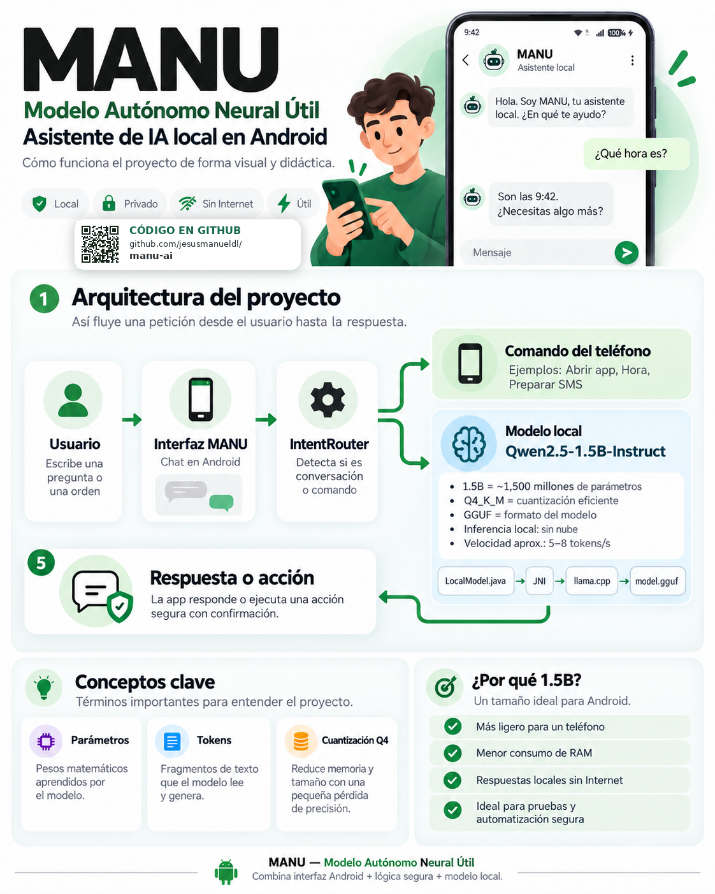

# MANU — Modelo Autónomo Neural Útil

Asistente conversacional local para Android. MANU combina un modelo GGUF
ejecutado en el dispositivo con herramientas nativas de Android y memoria
persistentemente local mediante SQLite.



La infografía resume visualmente la arquitectura, el flujo de una petición y
la relación entre la interfaz Android, el router de herramientas y el modelo
local. El código fuente está disponible en
[github.com/jesusmanueldl/manu-ai](https://github.com/jesusmanueldl/manu-ai).

## Qué incluye

- Chat Android nativo en Java.
- Inferencia local con Qwen 2.5 1.5B Instruct Q4_K_M y llama.cpp.
- Puente JNI para ARM64.
- Memoria de conversación en SQLite.
- Herramientas locales: RAM, almacenamiento, batería, CPU y aplicaciones.
- Apertura de aplicaciones reconocidas y preparación de SMS con confirmación.
- Gráfica visual de la inferencia y métrica aproximada de generación.
- Interfaz sin servidores y sin enviar conversaciones a internet.

## Arquitectura detallada

```text
Usuario
  ↓
MainActivity — interfaz de chat, teclado, estado y métricas
  ↓
IntentRouter ────── herramientas Android
  │                  ├─ RAM, almacenamiento, batería y CPU
  │                  ├─ aplicaciones instaladas y apertura de apps
  │                  └─ SMS preparado con confirmación
  ↓
MemoryStore — SQLite privado: mensajes y memoria autorizada
  ↓
LocalModel — ExecutorService, copia segura del GGUF y streaming
  ↓
PromptConfig → JNI → llama.cpp → Qwen 2.5 1.5B Q4_K_M
```

MANU usa una arquitectura híbrida. Las consultas sobre el teléfono se
resuelven con APIs Android para obtener datos reales y rápidos. Las preguntas
generales se envían al modelo GGUF. El modelo nunca recibe permisos para
ejecutar acciones directamente: la aplicación valida y ejecuta las
herramientas.

## Qué ocurre al enviar un mensaje

1. La interfaz guarda el mensaje en SQLite.
2. `IntentRouter` comprueba si coincide con una herramienta local conocida.
3. Si es una herramienta, Android devuelve el resultado directamente.
4. Si es una pregunta general, `MemoryStore` prepara un contexto limitado.
5. `LocalModel` ejecuta la inferencia fuera del hilo de interfaz.
6. JNI transmite tokens parciales y métricas al lado Java.
7. La respuesta final se muestra y se guarda localmente.

El modelo se carga una sola vez por proceso y se reutiliza entre consultas.
Cada mensaje crea un contexto de inferencia independiente para evitar mezclar
estados internos entre conversaciones.

## Memoria y privacidad

SQLite se almacena en el espacio privado de la aplicación. La tabla `messages`
conserva el historial y `memories` permite guardar recuerdos autorizados. El
contexto se limita antes de llegar al motor para respetar la ventana de 1024
tokens y evitar duplicar la pregunta actual.

La aplicación no tiene implementada búsqueda web y no añade permisos de red.
La cámara, visión local y automatizaciones avanzadas son fases futuras. La
memoria se conserva al actualizar la aplicación, pero Android la elimina al
desinstalar MANU o borrar sus datos.

## Rendimiento del modelo

El modelo utiliza cuantización `Q4_K_M`, que reduce el tamaño y el consumo de
memoria frente a los pesos completos. El motor actual ejecuta en CPU ARM64;
no presupone una GPU compatible. La interfaz muestra:

- tokens del prompt;
- tokens generados;
- latencia hasta el primer token;
- tiempo total;
- velocidad real de generación en tokens por segundo.

El rendimiento depende de la temperatura, memoria disponible, longitud del
contexto y modelo instalado. Un modelo más grande puede mejorar la calidad,
pero aumentará el uso de RAM y el tiempo de respuesta.

## Qué no incluye

Por tamaño y licencias, este repositorio no contiene:

- Pesos del modelo GGUF.
- APKs, builds, logs o bases de datos.
- Datos personales o capturas del teléfono.
- La copia completa de llama.cpp.

Consulta [docs/REPLICATION.md](docs/REPLICATION.md) para descargar las
dependencias y reproducir el proyecto.

## Inicio rápido

```bash
git clone https://github.com/jesusmanueldl/manu-ai.git
cd manu-ai
git clone --depth 1 https://github.com/ggml-org/llama.cpp third_party/llama.cpp
```

Descarga el modelo por separado:

```powershell
python -m pip install -U huggingface_hub
.\scripts\download-model.ps1
```

Después abre el proyecto en Android Studio, sincroniza Gradle y ejecútalo en
un dispositivo Android ARM64 con depuración USB autorizada.

## Prompt del sistema

El prompt base de MANU está en
[`prompts/MANU_SYSTEM_PROMPT.txt`](prompts/MANU_SYSTEM_PROMPT.txt). Define la
identidad **Modelo Autónomo Neural Útil**, el comportamiento local, la
privacidad y la regla de no inventar acciones.

La versión utilizada durante la ejecución está centralizada en
`app/src/main/java/com/manu/ai/PromptConfig.java`; el archivo de `prompts/`
funciona como referencia editable y documentación del comportamiento esperado.

## Seguridad

MANU separa el modelo de las herramientas. El modelo propone o interpreta una
petición; la aplicación decide si una herramienta es válida y ejecuta la acción.
SMS, llamadas, borrados y cambios sensibles deben pedir confirmación explícita.

## Licencias

Revisa las licencias de este proyecto, Qwen y llama.cpp antes de redistribuir
una aplicación o un modelo. Los pesos se descargan directamente desde su
repositorio correspondiente y no se redistribuyen aquí.

## Estado

La rama principal contiene la base funcional. La rama
`stabilize/technical-phase-1` añade la estabilización del modelo privado,
reutilización JNI, contexto acotado, streaming y métricas reales. La cámara,
visión local, búsqueda web y automatizaciones avanzadas quedan como fases
posteriores.

## Documentación adicional

- [Guía completa de replicación](docs/REPLICATION.md)
- [Prompt de MANU](prompts/MANU_SYSTEM_PROMPT.txt)
- [Compilación de JNI](scripts/build-native.ps1)
